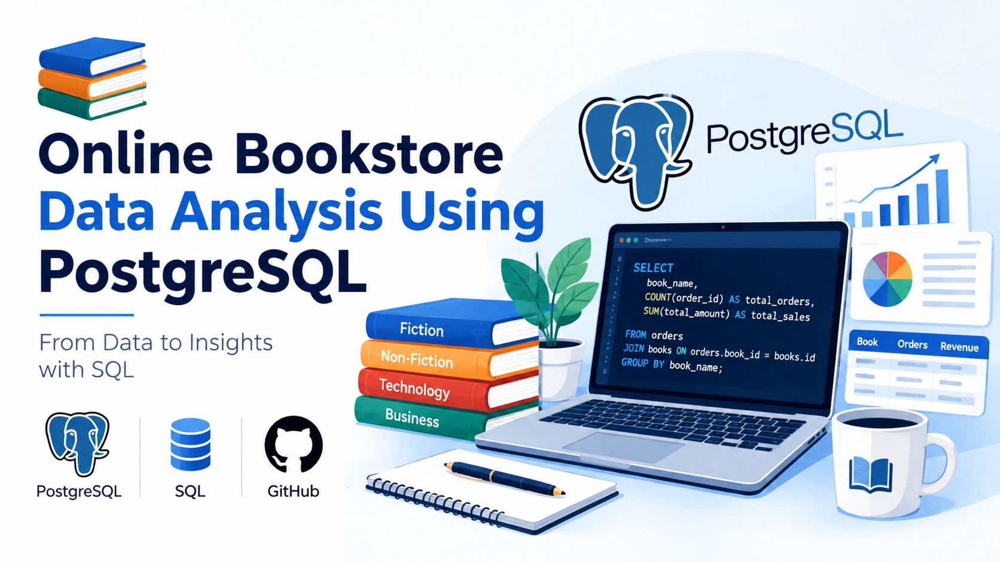

  

# Online Bookstore Data Analysis Using PostgreSQL

## Project Overview
This project focuses on analyzing an online bookstore database using
PostgreSQL. It uses three datasets: Books, Customers, and Orders to
explore book inventory, customer information, sales performance, and
order trends.

## Tools & Technologies
- PostgreSQL
- SQL
- CSV datasets

## Database Tables
- Books
- Customers
- Orders

## Key SQL Concepts
- SELECT, WHERE, ORDER BY
- GROUP BY and aggregate functions
- JOIN operations
- Subqueries
- Date filtering
- DISTINCT and LIMIT
- Sales and inventory analysis

## Key Insights
- Analyzed book prices, genres, and available stock.
- Explored customer and order information.
- Identified popular genres based on ordered quantities.
- Calculated total sales revenue and units ordered.
- Used SQL queries to answer basic and advanced business questions.

## Project Objective
To strengthen SQL skills and demonstrate practical database querying
and data analysis using a bookstore business scenario.
